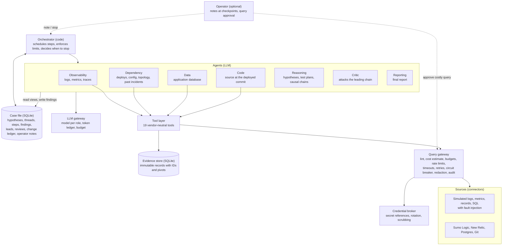
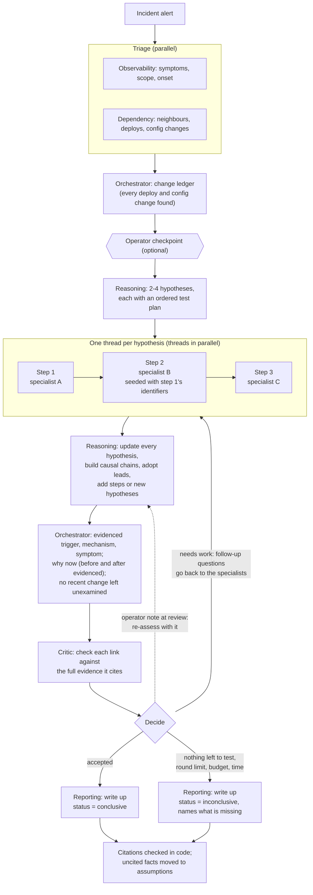

# Architecture

## Components

Three boundaries carry most of the design:

- **Agents never touch a source directly.** Every query goes through the query gateway, which checks it against the source's policy before it runs (read-only single SELECT, indexed filter required, bounded time windows, counts before raw log lines, per-query and per-investigation cost caps), then applies timeouts, bounded retries, a circuit breaker, row caps and redaction. A refusal comes back with the reason and a way forward, so the agent can correct itself.
- **Agents never see credentials.** Source configs hold references (`secret://sumo/prod#access_key`). The broker resolves them at call time, re-reads on an auth failure (rotation), and registers every value with a scrubber that removes it from anything returned to an agent or written to a log.
- **Agents never quote tool output in conclusions.** A tool result becomes evidence records with IDs (`log:fivo-api:0012`). Findings, causal chains and the report cite IDs, and code checks every citation against the store.

## How an investigation runs

### Why threads, not fan-out

A real investigation is a chain of hops, each chosen from the last: error counts by route → raw lines for the failing route → the trace ID from a line → the database rows for that user → the deploy before the onset → the diff of that deploy → the function it changed. A design that queries every source in parallel and merges the results cannot do this, because the second query depends on the answer to the first.

So the unit of work is a **thread**: the ordered steps that test one hypothesis. Inside a thread, steps run strictly in order, and each specialist receives the earlier steps' answers and findings plus the identifiers found so far (trace IDs, user IDs, commit SHAs, error fingerprints). Across hypotheses, threads run in parallel, since they are independent. Triage also runs its two agents in parallel.

### Why now: what changed, not just what failed

"The API returned 502s because the pool was exhausted" says what failed. The root cause is what is different from when the system last worked, and that is the part an investigation most easily skips. Three mechanisms make it non-optional:

1. **Change ledger.** Every deploy and configuration change any agent's tools return is added, in code, to a ledger in the case file, with its timing relative to the onset. Reasoning must give each change inside the lookback (24 hours by default) a disposition, `cause`, `contributing` or `ruled_out`, with a reason from the evidence. A disposition without a reason is ignored. While a recent change is unexamined, no hypothesis can be marked supported, so "we found a cause and never looked at the other deploy" cannot be reported as conclusive.
2. **Before and after.** A supported hypothesis needs a `why_now`: what changed, when, the state before with evidence and the state after with evidence. A diff, a config record with old and new values, or a count with a baseline can serve both sides. If the faulty code or setting already existed before the onset, `why_not_earlier` must say what made it fail now (load, data, an upstream, a quota). Missing or uncited sides are a structural gap: the orchestrator caps confidence and the hypothesis is not supported.
3. **Baseline comparison in the tools.** `logs_count` and `metrics_query` accept `baseline_start` and `baseline_end`. The evidence record then holds both periods: for logs, per group, what is new, gone or changed at the same rate; for metrics, the baseline's min, max and mean and the change in the mean. "New since baseline: route=/transactions status=500" is one citable record.

The Critic reviews `why_now` as its own link, and is shown the ledger with each disposition so it can challenge a change that was set aside without a real reason. Where no change of ours exists (an upstream degrades, a bad record arrives, traffic grows), the before and after come from metrics, counts or rows, and the ledger shows that the recent deploys were examined and ruled out. The report opens with "What changed" and lists every change considered.

### Human in the loop

An operator is optional; the graded evaluation runs without one. When present (`--interactive`, or any async callable passed as `operator`):

- **After triage,** before hypotheses exist, the operator sees the symptoms and the change ledger and can add what they know ("we rotated the storage keys this morning").
- **After each round's review,** they see the ranked hypotheses, what each says changed, the Critic's verdict and what happens next. They can let it continue, stop it, or add a note.
- **Costly queries** above a source's soft cap go to the same person for a yes or no.

A note is context, not a command and not evidence. It is shown to the agents labelled as such, cannot be cited, and anything resting on it alone is reported as an assumption. A note at review triggers a re-assessment by Reasoning, which may add steps or hypotheses; a conclusion still needs the Critic's acceptance. If the operator cannot be reached, the checkpoint is skipped and the investigation continues.

### How the agents collaborate

Agents do not message each other. They read from and write to the case file, which is the shared state:

| What is shared | Written by | Read by |
|---|---|---|
| Triage findings and onset | Observability, Dependency | Reasoning (to plan), every specialist |
| Hypotheses and test plans | Reasoning | Orchestrator (to schedule), specialists |
| Step answers, findings with stance and evidence IDs | Specialists | Later steps in the thread, other threads, Reasoning, Critic |
| Identifiers (pivots) | Tool layer, from the data | The next specialist's prompt |
| Leads (something unexpected, outside the question asked) | Specialists | Reasoning, which adopts or dismisses them and may open a hypothesis |
| Causal chain: trigger, mechanism, symptom | Reasoning | Critic, Reporting |
| Reviews and follow-up questions | Critic | Orchestrator, which turns them into steps for specialists |
| Change ledger and dispositions | Orchestrator (from evidence), Reasoning (dispositions) | Reasoning, Critic, the report |
| Operator notes | Human operator | Every agent, labelled as not evidence |

Four feedback loops follow from this:

1. **Within a thread:** what one specialist finds changes what the next is asked and which identifiers it uses.
2. **Assess → plan:** after each round, Reasoning can extend a thread, open a hypothesis from a lead, or refute its own favourite.
3. **Critic → specialists:** a `needs_work` verdict carries specific questions that run as new steps before the next review.
4. **Thread cut:** a strong contradiction stops a thread early and its remaining steps are skipped.

### What is code and what is a model

The orchestrator is deliberately not a model. Judgement belongs to the agents: what to test, what a result means, whether a chain holds. Control is deterministic, so it can be tested and bounded:

- scheduling (which steps are ready, how many threads at once)
- limits: rounds, hypotheses, steps per thread, attempts per step, tool calls per step, model calls, tokens and cost in dollars, source queries, wall-clock time
- the rule that a chain with a missing or unevidenced link cannot be marked supported
- the rule that a supported hypothesis needs an evidenced before and after, and that no recent change is left unexamined
- the rule that a report is conclusive only if the Critic accepted the leading hypothesis in the current round at or above the confidence threshold
- citation checks: invented evidence IDs are removed, an "observed" finding with no real evidence becomes "inferred", a "fact" with no valid citation is moved to assumptions

### Failure handling

| Failure | What happens |
|---|---|
| Query refused by a guardrail | The agent gets the violation and a hint, and adjusts the query |
| Source times out or errors | Gateway retries with backoff (bounded); then the agent sees the failure, tries another route and records the gap in `tool_problems` |
| Source keeps failing | Circuit breaker opens; calls return `unavailable` at once instead of burning the budget |
| Partial result (the source returned less than it should; a row cap alone does not count) | Evidence is marked partial; the orchestrator flags any chain that relies on it and the Critic is told |
| Model call fails or stalls | The client gives up after 240 s and retries twice; then one more retry inside the agent loop for transient errors |
| Output schema too large for constrained output | The schema is given in the instructions instead, and the output is validated in code |
| Model spend reaches the dollar ceiling | No further model calls; the report is assembled from the case file |
| Agent returns invalid output | One repair round, then the step fails |
| Step fails | Retried once; then marked failed, the thread continues with its next step, and the failure is listed in the report |
| Planning fails | The investigation ends as inconclusive with what triage found |
| Reporting agent fails or budget is gone | A report is assembled from the case file in code |
| Any limit reached | The loop stops and reports inconclusive, naming what is missing |
| Operator unreachable at a checkpoint | The checkpoint is skipped and logged; the investigation continues |
| Baseline query fails | The tool returns the main window with a note; the record holds no comparison |

## Evidence model

Each evidence record has an ID, a kind (`log`, `logagg`, `metric`, `trace`, `db`, `deploy`, `config`, `topology`, `incident`, `commit`, `changes`, `diff`, `code`, `codehit`), a one-line summary, the data, a timestamp, and pivots. A query that matches nothing is recorded too ("No deploys found for fivo-worker…"), because absence is often what rules a hypothesis out. The same observation seen twice keeps its first ID.

## Running against real systems

The same agents run against real sources by changing configuration only: `config/sources.example.yaml` shows Sumo Logic for logs, New Relic (NRQL templates) for metrics, Postgres for the database and Git for code. The `capabilities` block decides which source answers each kind of question; a capability with no source is simply not offered to the agents.

## Evaluation design

A generator builds each scenario from a small model of the application: telemetry files, a seeded database, real git repositories with real commits, and a hidden answer key that no source can read. Both systems run on a fresh copy of the same sources with the same guardrails and the same injected tool failures. See `evaluation.py` for the metrics and [RESULTS.md](RESULTS.md) for results.

The design board with earlier iterations is at https://www.figma.com/board/yM2tnGA4EVsuYCUXv5CtKL.
